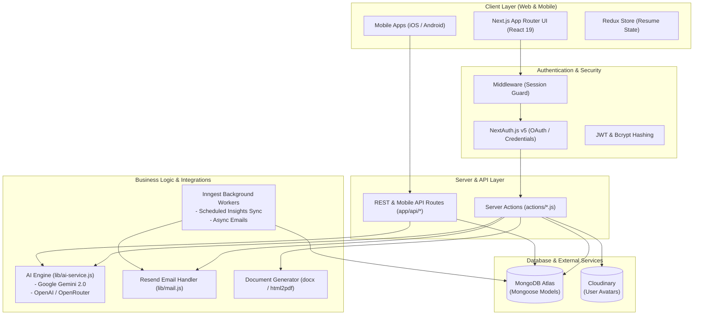
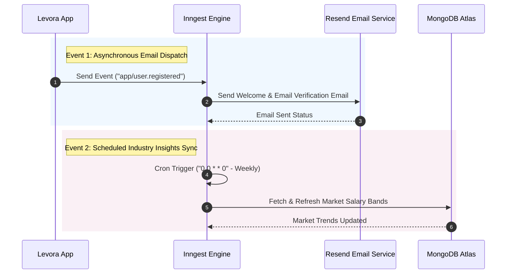

# 🚀 Levora — AI-Powered Career Coach & Professional Guidance Platform

**Levora** is an end-to-end, modern, AI-powered career growth and intelligent coaching platform. Built to empower job seekers, professionals, and students, Levora automates resume optimization, cover letter generation, mock interview prep with instant feedback, market/salary analytics, and targeted job discovery.

---

## 📋 Table of Contents
1. [Overview & Value Proposition](#-overview--value-proposition)
2. [Tech Stack & Dependencies](#-tech-stack--dependencies)
3. [Core Capabilities & Features](#-core-capabilities--features)
4. [Architecture & System Design](#-architecture--system-design)
5. [Complete Directory & File Map](#-complete-directory--file-map)
6. [Database Models & Schema Design](#-database-models--schema-design)
7. [Server Actions & Mobile API Endpoints](#-server-actions--mobile-api-endpoints)
8. [AI Engine & Prompts Infrastructure](#-ai-engine--prompts-infrastructure)
9. [Background Processing & Event Workflows](#-background-processing--event-workflows)
10. [Export & Document Processing System](#-export--document-processing-system)
11. [Design System, UI & Styling](#-design-system-ui--styling)
12. [Environment Variables Reference](#-environment-variables-reference)
13. [Getting Started & Local Development](#-getting-started--local-development)

---

## 🌟 Overview & Value Proposition

In today's highly competitive hiring landscape, traditional job applications often fail to stand out against Automated Tracking Systems (ATS) and human screeners. Levora bridges this gap by offering:
- **Tailored AI Guidance**: Custom feedback adapted to the candidate's industry, years of experience, and desired career track.
- **ATS-Optimized Resumes & Cover Letters**: Real-time bullet improver, dynamic keyword alignment, and direct export to Microsoft Word (`.docx`) and high-resolution PDF (`.pdf`).
- **Realistic Mock Interviews**: Dynamic role-playing interview prep that records user responses and calculates quantitative scores (0-100), key takeaways, and tailored improvement recommendations.
- **Real-time Market & Salary Insights**: Aggregated demand scores, salary progression curves, and in-demand skills for tech, finance, marketing, design, and executive domains.
- **Cross-Platform Compatibility**: Full web UI built on Next.js 15 + Tailwind CSS v4, complemented by a dedicated mobile API suite (`/api/mobile/*`) for mobile app integration.

---

## 🛠️ Tech Stack & Dependencies

### Core Framework & State Management
- **Framework**: [Next.js 15.5.9](https://nextjs.org/) (App Router, React Server Components, Server Actions)
- **Runtime & UI**: [React 19.0.0](https://react.dev/) / React DOM 19.0.0
- **State Management**: [Redux Toolkit 2.5.1](https://redux-toolkit.js.org/) (`@reduxjs/toolkit` & `react-redux 9.2.0`) for client-side state synchronization (Resume Builder state).

### Authentication & Authorization
- **Authentication Framework**: [NextAuth.js v5](https://next-auth.js.org/) (`next-auth@5.0.0-beta.31`)
- **Identity Providers**: Google OAuth 2.0 & Credentials (Email/Password)
- **Security & Tokens**: `bcryptjs 3.0.3` for password hashing, `jsonwebtoken 9.0.3` for custom verification and reset tokens.
- **Middleware Guard**: `middleware.js` enforcing protected routes for authenticated users and onboarding completion checks.

### Database & Cloud Storage
- **Database Engine**: [MongoDB](https://www.mongodb.com/) hosted on MongoDB Atlas
- **ODM**: [Mongoose 9.4.1](https://mongoosejs.com/) with connection pooling and caching (`lib/mongoose.js`).
- **Media Asset Storage**: Cloudinary (`cloudinary 2.10.0`) for hosting user profile avatars and upload artifacts.

### Artificial Intelligence & LLM Integration
- **Primary LLM**: Google Gemini 2.0 Flash / Pro via `@google/genai` (v1.17.0) and `@google/generative-ai` (v0.24.1).
- **Secondary / Fallback LLM**: OpenAI GPT models & OpenRouter integration (`openai 6.29.0`).
- **Unified Engine**: `lib/ai-service.js` wrapping multi-provider AI requests with fallback strategies.

### Asynchronous Jobs & Communication
- **Background Task Runner**: [Inngest 3.54.0](https://www.inngest.com/) for cron schedules, background email sending, and asynchronous industry data sync.
- **Webhook Management**: Svix (`svix 1.90.0`) for event ingestion and verification.
- **Transactional Emails**: [Resend 6.12.2](https://resend.com/) for email verification, password reset links, welcome emails, and activity notifications.
- **Push Notifications**: OneSignal (`onesignal-server`) integration.

### Document Generation & Formatting
- **DOCX Generation**: `docx 8.5.0` for structured Microsoft Word generation.
- **PDF Generation**: `html2pdf.js 0.12.0` / `html2pdf 0.0.11` for client-side visual PDF rendering.

### Frontend UI & Styling System
- **CSS Architecture**: Tailwind CSS v4 (`@tailwindcss/postcss` & `tailwindcss 4.0.0`)
- **Animation Framework**: Framer Motion (`framer-motion 12.38.0`) & `tw-animate-css 1.3.7`
- **Iconography**: Lucide React (`lucide-react 0.542.0`)
- **Theme Manager**: `next-themes 0.4.6` (Light / Dark mode toggle)
- **UI Primitives**: Radix UI (`@radix-ui/react-*` Accordion, Alert Dialog, Dialog, Dropdown Menu, Label, Progress, Radio Group, Select, Slot, Tabs)
- **Form Controls & Validation**: React Hook Form (`react-hook-form 7.62.0`), `@hookform/resolvers 5.2.1`, and Zod (`zod 3.23.8`)
- **Markdown Editing**: `@uiw/react-md-editor 4.0.8` for live interactive markdown previews.
- **Data Visualization**: Recharts (`recharts 3.1.2`) for analytical salary graphs and performance trends.
- **Toasts & Feedback**: Sonner (`sonner 2.0.7`) for modern UI alerts.

---

## ✨ Core Capabilities & Features

### 1. 🔐 User Authentication & Onboarding
- **Multi-Method Sign-In**: Login via Google OAuth or traditional Email/Password credentials.
- **Email Verification**: Secure link verification powered by Resend (`lib/tokens.js` & `lib/mail.js`).
- **Password Recovery**: Self-service password reset flow with token expiration.
- **Tailored Onboarding**: 4-step wizard capturing industry, specialization, experience level, key skills, and bio. Profile completion status directs users to personalized dashboards.

### 2. 📝 AI-Powered Resume Builder
- **Structured Sections**: Contact details, professional summary, work experience, education, key projects, technical skills, and custom user sections.
- **AI Content Optimizer**: Refines bullet points into high-impact, STAR-method statements tuned for ATS systems.
- **Real-Time Markdown Editor**: Split-screen live preview editing via `@uiw/react-md-editor`.
- **Redux State Sync**: Auto-saves active edits in Redux (`resumeSlice.js`) and syncs to MongoDB (`actions/resume.js`).
- **Multi-Format Export**: Download resumes as clean `.pdf` or fully editable `.docx` files.

### 3. ✉️ AI Cover Letter Generator
- **Job Description Analysis**: Matches candidate skills against candidate target job titles and company descriptions.
- **Tone & Customization**: Generates persuasive, professionally framed cover letters.
- **Draft Management**: Save, edit, view history, copy to clipboard, or export cover letters.

### 4. 🎤 AI Mock Interview Prep & Scoring
- **Dynamic Question Generation**: Custom questions based on chosen industry, target position, and experience tier.
- **Interview Recording & Transcription**: Capture user input and evaluate answer clarity, conciseness, and relevance.
- **AI Assessment & Feedback**: Calculates an overall score (0-100), highlights key strengths, identifies improvement areas, and suggests model answers.

### 5. 📊 Smart Career Dashboard & Market Analytics
- **Performance Overview**: Overall readiness score, completed resumes, interview attempts, and cover letter counts.
- **Industry Trend Caching**: Visualized salary distribution graphs, demand index indicators, and top skills requested in the job market (`models/IndustryInsight.js`).
- **Automated Background Refresh**: Inngest cron job routinely updates industry stats.

### 6. 💼 Job Discovery & Recommendations
- **Job Finder Module**: Matches user profiles against curated job listings (`data/jobs.js` & `actions/jobs.js`).
- **Filtering & Search**: Filter jobs by industry, location, workplace type (Remote/Hybrid/Onsite), and salary ranges.

### 7. 📱 Mobile API Endpoints (`/api/mobile/`)
- Mobile REST API suite allowing native apps (iOS / Android / React Native / Flutter) to connect:
  - `/api/mobile/login` & `/api/mobile/register` — JWT Token auth.
  - `/api/mobile/me` — Current user profile retrieval & updates.
  - `/api/mobile/dashboard` — Mobile metrics payload.
  - `/api/mobile/insights` — Industry salary & trend APIs.
  - `/api/mobile/resume` — Resume fetching & updating.
  - `/api/mobile/cover-letter` — Cover letter creation & history.
  - `/api/mobile/interview` — Mock interview APIs.

### 8. ⭐ Community Reviews & Feedback
- Interactive customer reviews form (`ReviewForm.jsx`).
- Animated review showcase marquee (`ReviewGrid.jsx` & `MarqueeReviews.jsx`).

---

## 🏗️ Architecture & System Design



---

## 📂 Complete Directory & File Map

```text
levora/
├── actions/                         # Next.js Server Actions (Database & Async Actions)
│   ├── auth.js                      # Signup, Login helper, Password recovery, Email verification
│   ├── cover-letter.js              # CRUD for cover letters & AI generation triggers
│   ├── dashboard.js                 # Metrics summary and user stats calculation
│   ├── heroStats.js                 # Landing page statistical counters
│   ├── industryInsight.js           # Industry trends fetch, update & background refresh
│   ├── interview.js                 # Mock interview creation, response evaluation & scoring
│   ├── jobs.js                      # Job listing search and filter actions
│   ├── notifications.js             # User alerts & notification management
│   ├── profile.js                   # Profile updates, onboarding submission & Cloudinary uploads
│   ├── resume.js                    # Resume saving, fetching, section updates & ATS scoring
│   ├── review.js                    # User review submission & rating aggregation
│   └── user.js                      # Helper utility user actions
│
├── app/                             # Next.js 15 App Router Directory
│   ├── (auth)/                      # Auth Route Group
│   │   ├── complete-profile/        # Profile completion wizard
│   │   ├── forgot-password/         # Forgot password email form
│   │   ├── login/                   # Standard sign-in page
│   │   ├── register/                # User registration page
│   │   ├── reset-password/          # Token-validated password reset page
│   │   ├── sign-in/                 # NextAuth helper sign-in container
│   │   ├── sign-up/                 # NextAuth helper sign-up container
│   │   ├── verify-email/            # Email confirmation token receiver page
│   │   └── layout.js                # Auth visual layout container
│   │
│   ├── (main)/                      # Main Application Route Group (Protected)
│   │   ├── cover-letter/            # Cover letter generator & manager page
│   │   ├── dashboard/               # Main user dashboard page & components
│   │   │   └── _components/         # Dashboard visual widgets & charts
│   │   │       ├── InsightTopHalf.jsx
│   │   │       ├── PerformanceChart.jsx
│   │   │       └── DashboardOverview.jsx
│   │   ├── interviewprep/           # Mock interview generator & quiz interface
│   │   ├── job-finding/             # Job discovery board
│   │   ├── onboarding/              # User initial setup wizard
│   │   ├── profile/                 # Profile management page
│   │   ├── resume/                  # Interactive resume editor page & components
│   │   ├── settings/                # User account security & preferences
│   │   └── layout.js                # Authenticated layout with header & sidebar navigation
│   │
│   ├── api/                         # Backend API Route Handlers
│   │   ├── auth/[...nextauth]/      # NextAuth.js API Handler
│   │   ├── inngest/                 # Inngest endpoint handler
│   │   ├── mobile/                  # Native Mobile App REST Endpoints
│   │   │   ├── cover-letter/        # Mobile Cover Letter endpoints
│   │   │   ├── dashboard/           # Mobile Dashboard metrics endpoint
│   │   │   ├── insights/            # Mobile Industry Insights endpoint
│   │   │   ├── interview/           # Mobile Interview Prep endpoints
│   │   │   ├── login/               # Mobile JWT authentication endpoint
│   │   │   ├── me/                  # Mobile User Profile endpoint
│   │   │   ├── register/            # Mobile User Registration endpoint
│   │   │   └── resume/              # Mobile Resume Management endpoints
│   │   └── webhooks/                # External webhook handler (Svix / Inngest)
│   │
│   ├── form-lib/                    # Form definitions and Zod validation schemas
│   ├── globals.css                  # Modern CSS styles & Tailwind v4 directive setup
│   ├── icon.jsx                     # Dynamic web app metadata icons
│   ├── layout.js                    # Root Layout with ThemeProvider & ReduxProvider
│   ├── not-found.jsx                # Custom styled 404 page
│   └── page.jsx                     # Conversion-optimized Landing Page
│
├── components/                      # Reusable UI & Layout Components
│   ├── ui/                          # Radix UI primitives & styled components (Button, Dialog, etc.)
│   ├── DashboardMockup.jsx          # Hero interactive application dashboard mockup
│   ├── Footer.jsx                   # Global footer with navigation & legal links
│   ├── Header.jsx                   # Public guest header navigation bar
│   ├── HeaderAuth.jsx               # Authenticated header with user dropdown & actions
│   ├── Herosection.jsx              # Main hero section with animated CTA and stats
│   ├── MarqueeReviews.jsx           # Infinite scrolling review marquee component
│   ├── ReduxProvider.jsx            # React-Redux Provider context wrapper
│   ├── ReviewForm.jsx               # Interactive user feedback submission modal
│   ├── ReviewGrid.jsx               # Grid of user testimonials and ratings
│   └── theme-provider.jsx           # `next-themes` dark/light mode wrapper
│
├── data/                            # Static Datasets & Template Configurations
│   ├── faqs.js                      # Frequently Asked Questions dataset
│   ├── features.js                  # Platform core features dataset
│   ├── howItWorks.js                # Platform onboarding walkthrough steps
│   ├── industries.js                # Comprehensive list of industries, roles & salary bands
│   ├── jobs.js                      # Mock job postings dataset for job finder
│   ├── mock-interviews.js           # Industry preset interview question pools
│   └── testimonial.js               # Client success stories and quotes
│
├── hooks/                           # Custom React Hooks
│   └── use-fetch.js                 # Custom generic hook for server action executions
│
├── lib/                             # Utility Core & Integrations
│   ├── ai-service.js                # Unified Google Gemini & OpenAI service integration
│   ├── auth.js                      # NextAuth configuration options & callbacks
│   ├── checkUser.js                 # Session retriever & MongoDB user lookup utility
│   ├── cloudinary.js                # Cloudinary SDK configuration
│   ├── cover-letter-utils.js        # Formatting & cleanup helper for generated letters
│   ├── export-utils.js              # PDF (html2pdf) & MS Word (docx) conversion engines
│   ├── inngest/                     # Inngest Background Queue
│   │   ├── client.js                # Inngest client initialization
│   │   └── functions.js             # Async scheduled tasks & cron functions
│   ├── mail.js                      # Resend email templates & delivery logic
│   ├── mongoose.js                  # Cached Mongoose database connection provider
│   ├── onesignal-server.js          # OneSignal push notification integration
│   ├── resumeSlice.js               # Redux state slice for active resume drafting
│   ├── store.js                     # Redux Toolkit store setup
│   ├── tokens.js                    # Crypto token generation for email verify & reset
│   └── utils.js                     # `clsx` & `tailwind-merge` class merging utility
│
├── models/                          # Mongoose Database Schemas
│   ├── Assessment.js                # Interview prep history & AI scoring model
│   ├── CoverLetter.js               # Cover letter document model
│   ├── IndustryInsight.js           # Industry market trends & salary schema
│   ├── Notification.js              # Real-time user alert records model
│   ├── Resume.js                    # Complex structured user resume model
│   ├── Review.js                    # Platform review and feedback model
│   └── User.js                      # Core User account & career profile model
│
├── public/                          # Static Graphics, Favicons & Logos
├── scripts/                         # Database Migration & Maintenance Utilities
│   ├── fix-insight-index.mjs        # Script to re-index IndustryInsight collection
│   └── fix-profile.js               # Profile schema correction script
│
├── styles/                          # Global style overrides
├── .env                             # Environment Variables config file
├── middleware.js                    # Next.js authentication & route guard middleware
├── next.config.mjs                  # Next.js configuration (Cloudinary image domain setup)
├── package.json                     # Project manifest, scripts, and dependencies
└── project.md                       # Complete Project Documentation (This File)
```

---

## 🗄️ Database Models & Schema Design

### 1. `User` Schema (`models/User.js`)
Stores account identity, auth credentials, onboarding status, and overall career metadata.
```javascript
{
  name: { type: String },
  email: { type: String, unique: true, required: true },
  password: { type: String }, // Hashed with bcrypt
  image: { type: String },    // Cloudinary URL or OAuth avatar
  industry: { type: String }, // e.g., "Tech & Software", "Finance"
  specialization: { type: String },
  experience: { type: Number },
  skills: [{ type: String }],
  bio: { type: String },
  isOnboarded: { type: Boolean, default: false },
  emailVerified: { type: Date },
  createdAt: { type: Date, default: Date.now },
  updatedAt: { type: Date, default: Date.now }
}
```

### 2. `Resume` Schema (`models/Resume.js`)
Stores structured resume data, sections, custom content, and optional ATS evaluation score.
```javascript
{
  userId: { type: Schema.Types.ObjectId, ref: 'User', required: true },
  title: { type: String, default: 'My Resume' },
  contactInfo: {
    email: String,
    mobile: String,
    linkedin: String,
    github: String,
    twitter: String,
    website: String
  },
  summary: { type: String },
  skills: [{ type: String }],
  experience: [{
    title: String,
    company: String,
    location: String,
    startDate: String,
    endDate: String,
    current: Boolean,
    description: String
  }],
  education: [{
    degree: String,
    institution: String,
    location: String,
    startDate: String,
    endDate: String,
    gpa: String
  }],
  projects: [{
    title: String,
    description: String,
    technologies: [{ type: String }],
    link: String
  }],
  customSections: [{
    heading: String,
    content: String
  }],
  atsScore: { type: Number },
  atsFeedback: { type: String }
}
```

### 3. `CoverLetter` Schema (`models/CoverLetter.js`)
Tracks cover letters generated for target jobs.
```javascript
{
  userId: { type: Schema.Types.ObjectId, ref: 'User', required: true },
  jobTitle: { type: String, required: true },
  companyName: { type: String, required: true },
  jobDescription: { type: String },
  content: { type: String, required: true },
  status: { type: String, enum: ['draft', 'final'], default: 'draft' },
  createdAt: { type: Date, default: Date.now }
}
```

### 4. `Assessment` Schema (`models/Assessment.js`)
Logs user interview prep sessions, question sets, user answers, and AI-computed metrics.
```javascript
{
  userId: { type: Schema.Types.ObjectId, ref: 'User', required: true },
  quizType: { type: String, default: 'InterviewPrep' },
  industry: { type: String, required: true },
  quizScore: { type: Number, required: true }, // Score 0 - 100
  questions: [{
    question: String,
    userAnswer: String,
    answerExplanation: String,
    isCorrect: Boolean,
    score: Number
  }],
  improvementTip: { type: String },
  createdAt: { type: Date, default: Date.now }
}
```

### 5. `IndustryInsight` Schema (`models/IndustryInsight.js`)
Aggregates market stats, salary benchmarks, growth trends, and required skills by industry.
```javascript
{
  industry: { type: String, unique: true, required: true },
  salaryRanges: [{
    role: String,
    min: Number,
    median: Number,
    max: Number,
    location: String
  }],
  growthRate: { type: Number },
  demandLevel: { type: String, enum: ['High', 'Medium', 'Low'] },
  topSkills: [{ type: String }],
  marketOutlook: { type: String },
  nextUpdate: { type: Date }
}
```

### 6. `Notification` & `Review` Schemas (`models/Notification.js` & `models/Review.js`)
- `Notification`: User notifications and platform reminders.
- `Review`: User testimonials, star ratings (1-5), and feedback comments.

---

## ⚡ Server Actions & Mobile API Endpoints

### Server Actions Summary (`actions/`)

| Action File | Key Functions | Description |
| :--- | :--- | :--- |
| `auth.js` | `registerUser()`, `resetPassword()`, `sendVerificationEmail()` | User registration, password resets, email verification |
| `profile.js` | `updateProfile()`, `completeOnboarding()`, `uploadAvatar()` | User metadata, Cloudinary image upload, onboarding status |
| `resume.js` | `saveResume()`, `getResume()`, `improveWithAI()`, `calculateATSScore()` | Resume CRUD, AI bullet improver, ATS scoring engine |
| `cover-letter.js` | `generateCoverLetter()`, `getCoverLetters()`, `deleteCoverLetter()` | AI cover letter generation, history retrieval, deletion |
| `interview.js` | `generateInterviewQuestions()`, `saveAssessment()` | Mock interview AI question generator & score evaluation |
| `industryInsight.js` | `getIndustryInsight()`, `refreshIndustryInsights()` | Industry insights retrieval and manual/cron refresh |
| `jobs.js` | `getJobs()`, `getJobById()` | Job discovery filtering and details lookup |
| `heroStats.js` | `getHeroStats()` | Dynamic statistical stats for home page landing |
| `review.js` | `createReview()`, `getReviews()` | Submitting and retrieving public client reviews |

### Mobile REST Endpoints (`/api/mobile/*`)

| Endpoint | Method | Description |
| :--- | :--- | :--- |
| `/api/mobile/login` | POST | Authenticates user with credentials and returns JWT token |
| `/api/mobile/register` | POST | Creates new user account for mobile clients |
| `/api/mobile/me` | GET / PUT | Retrieves or updates current user profile |
| `/api/mobile/dashboard` | GET | Delivers user dashboard metrics and summary payload |
| `/api/mobile/resume` | GET / POST | Retrieves or saves user resume configuration |
| `/api/mobile/cover-letter` | GET / POST | Generates or lists saved cover letters |
| `/api/mobile/interview` | GET / POST | Mobile interface for interview prep & answers |
| `/api/mobile/insights` | GET | Provides real-time industry analytics & salary data |

---

## 🤖 AI Engine & Prompts Infrastructure

All AI operations pass through `lib/ai-service.js`, which wraps **Google Gemini** (`@google/genai` & `@google/generative-ai`) and **OpenAI** APIs.

### 1. Resume Bullet Improver Prompt
- Evaluates raw resume text against industry standards.
- Formats experience using action verbs, quantifiable achievements, and ATS keyword optimization.

### 2. ATS Score & Evaluation
- Compares resume text with user target industry/job titles.
- Outputs an overall match percentage (0-100), missing keywords, formatting flags, and actionable suggestions.

### 3. Tailored Cover Letter Generator
- Considers candidate history, target company name, job title, and full job description.
- Produces a captivating 3-4 paragraph cover letter customized to match the user's career tone.

### 4. Interactive Interview Evaluator
- Synthesizes user verbal/written answers to interview questions.
- Scores response accuracy, structural flow (STAR method), and provides exemplar answers for improvement.

---

## ⏰ Background Processing & Event Workflows

Levora utilizes **Inngest** (`lib/inngest/`) to process heavy or scheduled workloads without blocking HTTP client requests:



---

## 📄 Export & Document Processing System

Located in `lib/export-utils.js`, Levora provides dual document export options for resumes and documents:

### 1. Microsoft Word (`.docx`) Export
- Built using the `docx` library.
- Custom paragraph styling, font family specifications, clean margins, bullet list structures, and contact header layouts.
- Ensures compatibility with enterprise recruitment software and Word editors.

### 2. High-Resolution PDF (`.pdf`) Export
- Powered by `html2pdf.js`.
- Captures live DOM elements styled with standard print CSS rules (`@media print`).
- Guarantees visual fidelity matching the user's online preview.

---

## 🎨 Design System, UI & Styling

- **Design Philosophy**: Glassmorphism aesthetic, sleek dark mode default, subtle accent glows, crisp micro-interactions, and premium typography.
- **Colors**: Customized Tailwind HSL color tokens supporting seamless Light/Dark themes (`next-themes`).
- **Typography**: Clean sans-serif hierarchy utilizing modern web font stacks (`Inter` & `Geist`).
- **Data Visualizations**: Responsive charts (`recharts`) showcasing salary ranges and assessment progress over time.
- **Component Architecture**: Modular Radix UI primitives wrapped in accessible Tailwind CSS containers.

---

## 🔑 Environment Variables Reference

To run **Levora** locally or in production, configure the following keys in your `.env` file:

```bash
# -----------------------------------------------------------------------------
# APP CONFIGURATION
# -----------------------------------------------------------------------------
NEXT_PUBLIC_APP_URL=http://localhost:3000

# -----------------------------------------------------------------------------
# NEXTAUTH CONFIGURATION
# -----------------------------------------------------------------------------
NEXTAUTH_SECRET=your_generated_nextauth_secret # Generate using: npx auth secret
NEXTAUTH_URL=http://localhost:3000

# OAUTH PROVIDERS
GOOGLE_CLIENT_ID=your_google_oauth_client_id
GOOGLE_CLIENT_SECRET=your_google_oauth_client_secret

# -----------------------------------------------------------------------------
# DATABASE CONFIGURATION
# -----------------------------------------------------------------------------
MONGODB_URI=mongodb+srv://<username>:<password>@cluster0.mongodb.net/levora?retryWrites=true&w=majority

# -----------------------------------------------------------------------------
# AI SERVICES KEYS
# -----------------------------------------------------------------------------
GEMINI_API_KEY=your_google_gemini_api_key
GENERATIVE_AI_KEY=your_google_ai_studio_key
OPENAI_API_KEY=your_openai_api_key
OPENROUTER_API_KEY=your_openrouter_api_key

# -----------------------------------------------------------------------------
# TRANSACTIONAL EMAIL (RESEND)
# -----------------------------------------------------------------------------
RESEND_API_KEY=re_your_resend_api_key
EMAIL_FROM=Levora <noreply@yourdomain.com>

# -----------------------------------------------------------------------------
# CLOUDINARY STORAGE
# -----------------------------------------------------------------------------
CLOUDINARY_CLOUD_NAME=your_cloudinary_cloud_name
CLOUDINARY_API_KEY=your_cloudinary_api_key
CLOUDINARY_API_SECRET=your_cloudinary_api_secret

# -----------------------------------------------------------------------------
# BACKGROUND JOBS & WEBHOOKS (INNGEST & SVIX)
# -----------------------------------------------------------------------------
INNGEST_EVENT_KEY=your_inngest_event_key
INNGEST_SIGNING_KEY=your_inngest_signing_key
SVIX_TOKEN=your_svix_token
```

---

## 🚀 Getting Started & Local Development

### Prerequisites
- **Node.js**: v18.17.0 or higher
- **npm**: v9.0.0 or higher
- **MongoDB**: A running MongoDB instance or MongoDB Atlas cluster connection string.

### Step-by-Step Installation

1. **Clone the Repository**:
   ```bash
   git clone https://github.com/sarthak-shastrakar/levora.git
   cd levora
   ```

2. **Install Dependencies**:
   ```bash
   npm install
   ```

3. **Configure Environment Variables**:
   Copy `.env.example` (or create a `.env` file) in the project root and populate the environment variables as shown in the section above.

4. **Run Development Server**:
   ```bash
   npm run dev
   ```
   Open [http://localhost:3000](http://localhost:3000) in your browser to view Levora.

5. **Start Inngest Development Server (Optional for background jobs)**:
   ```bash
   npx inngest-cli@latest dev
   ```
   Open [http://localhost:8288](http://localhost:8288) to inspect background functions and event logs.

6. **Build for Production**:
   ```bash
   npm run build
   npm run start
   ```

---

*Documentation updated as of October 2026 for Levora.*
